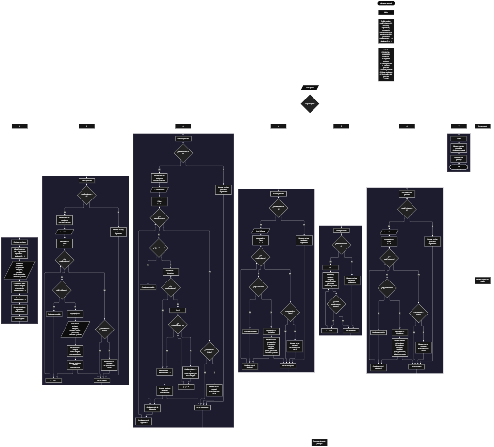

 

Este proyecto, llamado <b>almacén general</b>, fue desarrollado en <b>pseint</b> como un ejercicio práctico para fortalecer la lógica de programación mediante la creación de un sistema de gestión de productos desde la consola. El programa cuenta con un menú principal de siete opciones que permite <b>registrar, editar, eliminar, buscar, listar y consultar los detalles completos</b> de los productos almacenados. Cada producto contiene información como el identificador, el nombre, la categoría, la cantidad, el precio, el proveedor, la ubicación y el estado, utilizando ocho arreglos con una capacidad declarada de <b>100 posiciones cada uno</b>. Durante su desarrollo se aplicaron conceptos fundamentales de programación, como variables, arreglos, estructuras condicionales, ciclos repetitivos y estructuras de selección, además de procedimientos para buscar, modificar, eliminar y organizar registros. Este proyecto permite poner en práctica los conocimientos adquiridos en PSeInt y sirve como base para desarrollar sistemas de gestión de inventarios más avanzados utilizando otros lenguajes y tecnologías.

<h2 align="center">⚙️ Funcionamiento del menú principal</h2>

### ➕ Registrar producto

La opción <b>1) registrar producto</b> permite agregar un nuevo producto al almacén. Para comenzar, el programa asigna un identificador utilizando la variable <b>siguienteID</b>, que comienza en <b>1</b> y aumenta en uno después de cada asignación. A continuación, muestra el identificador asignado y solicita el <b>nombre del producto, la categoría, la cantidad, el precio, el proveedor, la ubicación y el estado</b>. Los datos se almacenan en sus respectivos arreglos utilizando la posición <b>totalProductos + 1</b>. Una vez introducida la información, la variable <b>totalProductos</b> aumenta en uno y el programa muestra el mensaje <b>"producto registrado correctamente."</b>. Aunque los arreglos tienen una capacidad declarada de 100 posiciones, el código actual no incluye una comprobación que impida registrar productos cuando se alcanza ese límite.

### ✏️ Editar producto

La opción <b>2) editar producto</b> permite modificar la información de un producto registrado. Primero, el programa comprueba si existen productos almacenados mediante la condición <b>totalProductos = 0</b>. Si no hay registros, muestra el mensaje <b>"no hay productos registrados."</b>. En caso contrario, presenta los datos registrados de cada producto, incluyendo el ID, el nombre, la categoría, la cantidad, el precio, el proveedor, la ubicación y el estado. Después, solicita el identificador del producto que se desea editar y almacena el valor introducido en la variable <b>idBuscar</b>. La variable lógica <b>encontrado</b> se inicializa con el valor <b>falso</b> y un ciclo <b>para</b> recorre los productos registrados. Cuando encuentra un identificador coincidente, cambia <b>encontrado</b> a <b>verdadero</b>, solicita los nuevos datos y actualiza directamente los valores de los arreglos correspondientes. Finalmente, muestra el mensaje <b>"producto editado correctamente."</b>. Si el ID no coincide con ningún producto, presenta el mensaje <b>"no se encontró un producto con ese id."</b>.

### 🗑️ Eliminar producto

La opción <b>3) eliminar producto</b> permite eliminar un producto registrado mediante su identificador. Antes de comenzar, el programa comprueba si existen productos almacenados. Si el almacén está vacío, muestra el mensaje <b>"no hay productos registrados."</b>. Si existen registros, presenta una lista con los datos de los productos y solicita el ID que se desea eliminar. El valor se almacena en la variable <b>idBuscar</b> y la variable lógica <b>encontrado</b> se inicializa en <b>falso</b>. Después, un ciclo <b>para</b> recorre los productos y compara sus identificadores. Cuando encuentra una coincidencia, establece <b>encontrado</b> en <b>verdadero</b>. Si el producto no ocupa la última posición, utiliza un segundo ciclo <b>para</b>, controlado por la variable <b>j</b>, para desplazar una posición hacia atrás los datos de los arreglos <b>id, producto, categoria, cantidad, precio, proveedor, ubicacion y estado</b>. Posteriormente, disminuye la variable <b>totalProductos</b> en uno y muestra el mensaje <b>"producto eliminado correctamente."</b>. Si no encuentra el identificador solicitado, presenta el mensaje <b>"no se encontró un producto con ese id."</b>. El código no limpia explícitamente la última posición después del desplazamiento y no interrumpe expresamente el recorrido al encontrar el producto.

### 🔎 Buscar producto

La opción <b>4) buscar producto</b> permite localizar un producto mediante su identificador. Primero, el programa comprueba si existen productos registrados. Si no hay registros, muestra el mensaje <b>"no hay productos registrados."</b>. En caso contrario, solicita el ID del producto y almacena el valor en la variable <b>idBuscar</b>. A continuación, inicializa la variable lógica <b>encontrado</b> con el valor <b>falso</b> y utiliza un ciclo <b>para</b> para recorrer los arreglos desde la primera posición hasta <b>totalProductos</b>. Cuando encuentra un producto cuyo identificador coincide con el solicitado, cambia la variable <b>encontrado</b> a <b>verdadero</b>, muestra el mensaje <b>"datos encontrados"</b> y presenta el ID, el nombre, la categoría, la cantidad, el precio, el proveedor, la ubicación y el estado. Si termina el recorrido sin encontrar una coincidencia, muestra el mensaje <b>"no se encontró un producto con ese id."</b>.

### 📋 Listar productos

La opción <b>5) listar productos</b> permite visualizar todos los productos registrados en el almacén. Antes de mostrar la información, el programa comprueba si la variable <b>totalProductos</b> es igual a cero. Si no existen registros, presenta el mensaje <b>"no hay productos registrados."</b>. Si hay productos disponibles, muestra el encabezado <b>"datos registrados"</b> y utiliza un ciclo <b>para</b> para recorrer las posiciones desde <b>1</b> hasta <b>totalProductos</b>. Durante el recorrido, presenta los ocho campos de cada producto: ID, nombre, categoría, cantidad, precio, proveedor, ubicación y estado. Esta operación permite consultar los registros existentes sin necesidad de buscar cada producto individualmente.

### 📄 Ver detalles del producto

La opción <b>6) ver detalles del producto</b> permite consultar individualmente la información completa de un producto específico. Primero, el programa comprueba si existen productos registrados. Si el almacén está vacío, muestra el mensaje <b>"no hay productos registrados."</b>. En caso contrario, solicita el identificador del producto que se desea consultar y almacena el valor en la variable <b>idBuscar</b>. Después, inicializa <b>encontrado</b> con el valor <b>falso</b> y recorre los registros mediante un ciclo <b>para</b>. Cuando encuentra un ID coincidente, cambia la variable lógica a <b>verdadero</b>, muestra el encabezado <b>"detalles del producto"</b> y presenta cada campo por separado: <b>ID, producto, categoría, cantidad, precio, proveedor, ubicación y estado</b>. Si finaliza el recorrido sin encontrar el producto, muestra el mensaje <b>"no se encontró un producto con ese id."</b>.

### 🚪 Salir del menú principal

La opción <b>7) salir</b> permite finalizar la ejecución del programa y muestra el mensaje <b>"gracias por utilizar el almacen general."</b>. El menú principal se encuentra dentro de una estructura repetitiva <b>repetir ... hasta que</b>, que mantiene el programa en funcionamiento mientras el usuario realiza las operaciones disponibles. La condición de salida es <b>hasta que opcion = 7</b>, por lo que coincide con el número asignado a la opción de salida. De esta manera, cuando el usuario selecciona la opción 7, se muestra el mensaje de despedida y termina el ciclo del menú principal.

<h2 align="center">🧠 Temas aplicados en el proyecto</h2>

### 📦 Variables

En este proyecto se utilizan variables para controlar la opción seleccionada en el menú, contabilizar los productos registrados, recorrer los arreglos, identificar el producto que se desea editar, eliminar o consultar, generar nuevos identificadores y comprobar si se encuentra una coincidencia. Cada variable cumple una función específica dentro de las operaciones del sistema de gestión del almacén.

🔢 **Opcion:** Almacena la opción seleccionada por el usuario en el menú principal.

📊 **TotalProductos:** Almacena la cantidad actual de productos registrados y permite controlar el recorrido de los registros activos.

🔄 **I:** Funciona como contador en los ciclos `para` y permite recorrer las posiciones de los arreglos.

🔁 **J:** Controla el recorrido utilizado para desplazar los datos de los productos posteriores durante la eliminación.

🔎 **IdBuscar:** Almacena el identificador introducido por el usuario para localizar un producto.

🆔 **SiguienteID:** Genera los identificadores consecutivos asignados a los nuevos productos.

✅ **Encontrado:** Variable lógica que indica si se localizó un producto con el identificador solicitado.

### 🗃️ Arreglos

En este proyecto se utilizan ocho arreglos relacionados con los datos de cada producto. Cada arreglo tiene una capacidad declarada de <b>100 posiciones</b> y utiliza el mismo índice para representar la información correspondiente a un mismo registro. Por ejemplo, los datos de un producto almacenado en la posición <b>1</b> se encuentran distribuidos entre <b>id[1], producto[1], categoria[1], cantidad[1], precio[1], proveedor[1], ubicacion[1] y estado[1]</b>. Esta organización permite recorrer, buscar, modificar, mostrar y eliminar los productos mediante sus posiciones correspondientes. La capacidad está definida en el dimensionamiento, pero el código no incorpora una validación para impedir superar las 100 posiciones.

🆔 **Id[100]:** Almacena los identificadores de los productos registrados.

📦 **Producto[100]:** Almacena los nombres de los productos.

🏷️ **Categoria[100]:** Almacena las categorías de los productos.

🔢 **Cantidad[100]:** Almacena las cantidades de los productos.

💲 **Precio[100]:** Almacena los precios de los productos utilizando el tipo de dato real.

🚚 **Proveedor[100]:** Almacena los nombres o datos de los proveedores.

📍 **Ubicacion[100]:** Almacena la ubicación de cada producto dentro del almacén.

📌 **Estado[100]:** Almacena el estado indicado para cada producto.

### 🔀 Estructuras condicionales

En este proyecto se utilizan las estructuras <b>si</b> y <b>sino</b> para comprobar si existen productos registrados antes de realizar determinadas operaciones, verificar si el identificador introducido coincide con alguno de los registros y determinar si se encontró el producto solicitado. También se utilizan para decidir si es necesario desplazar los registros durante una eliminación, mediante la condición <b>i &lt; totalProductos</b>. Estas condiciones permiten que el programa ejecute diferentes instrucciones según el estado de los registros y los resultados de las comparaciones.

### 🔄 Estructuras repetitivas

En este proyecto se utilizan los ciclos <b>para</b> y <b>repetir ... hasta que</b>. Los ciclos <b>para</b> permiten recorrer los arreglos para mostrar los productos, buscar identificadores, editar registros y localizar los datos que se desean eliminar o consultar. Durante la eliminación, un ciclo adicional controlado por la variable <b>j</b> desplaza los valores de los arreglos una posición hacia atrás. Por otro lado, el ciclo <b>repetir ... hasta que</b> mantiene activo el menú principal hasta que la variable <b>opcion</b> toma el valor <b>7</b>.

### 🎯 Estructura según

El programa utiliza la estructura <b>segun</b> para evaluar el valor almacenado en la variable <b>opcion</b> y ejecutar el bloque de instrucciones correspondiente. Cada caso representa una operación del sistema: <b>registrar, editar, eliminar, buscar, listar, ver detalles del producto o salir</b>. También se utiliza el bloque <b>de otro modo</b> para mostrar el mensaje <b>"opción no válida."</b> cuando el usuario introduce un valor que no coincide con ninguna de las opciones definidas en el menú. Esta estructura permite organizar las operaciones de manera clara y facilita la lectura del programa.

### 🔢 Dimensionamiento de arreglos

El programa utiliza la instrucción <b>dimension</b> para establecer la capacidad de los ocho arreglos que almacenan la información de los productos. Se definen <b>100 posiciones</b> para cada arreglo, lo que establece el espacio previsto para los registros. La cantidad de posiciones ocupadas se controla mediante la variable <b>totalProductos</b>, que comienza en cero y aumenta cada vez que se registra un producto. Al eliminar un producto, esta variable disminuye en uno. Sin embargo, aunque la capacidad está declarada, el programa no comprueba expresamente si se ha alcanzado el límite antes de registrar un nuevo producto.

### 🔄 Reorganización de registros

Cuando se selecciona un producto para eliminarlo, el programa utiliza un ciclo <b>para</b> controlado por la variable <b>j</b>, que comienza en la posición del producto encontrado y llega hasta <b>totalProductos - 1</b>. En cada repetición, los datos de la posición siguiente se copian sobre la posición actual en los ocho arreglos: <b>id, producto, categoria, cantidad, precio, proveedor, ubicacion y estado</b>. Después, la variable <b>totalProductos</b> disminuye en uno para actualizar la cantidad de registros activos. Este procedimiento permite desplazar los registros posteriores y mantenerlos en posiciones consecutivas. El código no limpia explícitamente la última posición ocupada después del desplazamiento.

<h2 align="center">¿Cómo se implementaron las operaciones crud en el proyecto?</h2>

Las operaciones <b>crud</b> se implementaron mediante las opciones del menú principal, permitiendo administrar los productos registrados en el almacén. La operación <b>crear</b> corresponde a <b>registrar producto</b>, donde se asigna un identificador y se introducen los datos de un nuevo registro; <b>leer</b> se realiza mediante las opciones <b>buscar producto, listar productos y ver detalles del producto</b>, que permiten consultar la información almacenada; <b>actualizar</b> corresponde a <b>editar producto</b>, donde se modifican los datos de un registro existente; y <b>eliminar</b> se realiza mediante la opción <b>eliminar producto</b>, que desplaza los registros posteriores y reduce el contador de productos. Estas operaciones utilizan variables, arreglos, estructuras condicionales y ciclos para gestionar la información durante la ejecución del programa.

<h2 align="center">Diagrama de flujo del proyecto</h2>

<h2 align="center">🛡️ Validaciones del programa</h2>

### 📭 No existen productos registrados

Esta comprobación se utiliza en las opciones de <b>editar, eliminar, buscar, listar y ver detalles del producto</b>. El programa verifica si la variable <b>totalProductos</b> es igual a <b>0</b>. Si no existen productos registrados, muestra el mensaje <b>"no hay productos registrados."</b> y no continúa con la operación que necesita acceder a los datos almacenados. Esta comprobación evita realizar búsquedas, modificaciones, eliminaciones o consultas sobre registros inexistentes cuando el almacén está vacío.

### ❌ Producto no encontrado

Esta validación se utiliza en las operaciones de <b>editar, eliminar, buscar y ver detalles del producto</b>. Antes de recorrer los arreglos, el programa inicializa la variable lógica <b>encontrado</b> con el valor <b>falso</b>. Durante el recorrido, compara los identificadores almacenados con el valor de <b>idBuscar</b>. Cuando encuentra una coincidencia, cambia la variable a <b>verdadero</b> y ejecuta las instrucciones correspondientes a la operación seleccionada. Si al finalizar el recorrido la variable continúa siendo <b>falso</b>, muestra el mensaje <b>"no se encontró un producto con ese id."</b>. De esta manera, el programa informa al usuario cuando el identificador introducido no corresponde a un producto localizado en los registros activos.

### ⚠️ Capacidad máxima de los arreglos

Los ocho arreglos del programa tienen una capacidad declarada de <b>100 posiciones</b>. Sin embargo, la operación <b>registrar producto</b> utiliza directamente la posición <b>totalProductos + 1</b> sin comprobar previamente si la cantidad de productos registrados es menor que <b>100</b>. Por lo tanto, el código actual no incorpora una validación que impida superar la capacidad declarada. Para controlar este límite, sería necesario agregar una condición que compruebe si existe espacio disponible antes de asignar un nuevo identificador y solicitar los datos del producto.

### 🔢 Identificadores consecutivos

El programa utiliza la variable <b>siguienteID</b> para asignar identificadores a los nuevos productos. Esta variable comienza en <b>1</b> y aumenta en uno cada vez que se registra un producto. Al eliminar un registro, el programa disminuye <b>totalProductos</b>, pero no modifica <b>siguienteID</b>. Por este motivo, los identificadores de los productos nuevos continúan avanzando y no se reutilizan automáticamente los identificadores de los productos eliminados. El identificador funciona como referencia para localizar cada producto durante las operaciones de gestión.

### ⚠️ Opción no válida

La estructura <b>segun</b> incluye el bloque <b>de otro modo</b>, que muestra el mensaje <b>"opción no válida."</b> cuando el usuario introduce un valor que no corresponde a ninguna de las siete opciones definidas en el menú principal. Esta respuesta permite informar que la selección no coincide con las operaciones disponibles. El código no incorpora una validación adicional del tipo de entrada antes de leer la opción seleccionada.

### 💾 Almacenamiento temporal de los datos

La información de los productos se almacena en los arreglos definidos mediante la instrucción <b>dimension</b>. El programa permite registrar, consultar, modificar y eliminar datos mientras se encuentra en ejecución. Sin embargo, no utiliza archivos, bases de datos ni mecanismos de persistencia para guardar la información. Por ello, los registros se mantienen en la memoria utilizada por el programa durante su ejecución y no existe en el código un procedimiento para recuperarlos automáticamente después de finalizarlo.

<h2 align="center">🎯 Objetivo del proyecto</h2>

El objetivo principal de este proyecto es fortalecer la <b>lógica de programación</b> mediante el desarrollo de un sistema de gestión de productos en <b>pseint</b>. A través de su construcción se busca aplicar los conocimientos adquiridos sobre variables, arreglos, estructuras condicionales, ciclos repetitivos y estructuras de selección, integrándolos para resolver un problema de manera organizada. Además, el proyecto permite comprender cómo registrar, consultar, modificar, buscar y eliminar información en una aplicación de consola, utilizando identificadores para localizar los productos y arreglos para organizar sus datos. De esta manera, se establece una base para desarrollar sistemas de inventario más completos y aplicar estos conocimientos en otros lenguajes de programación y tecnologías.

